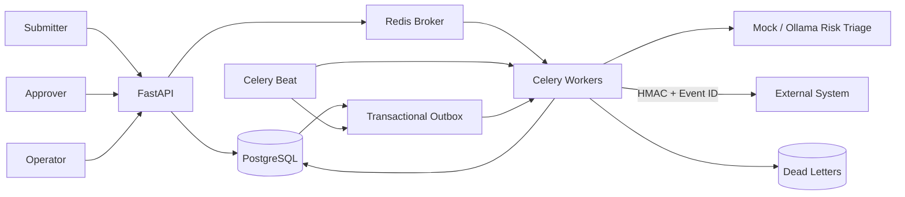

# Architecture

## System goal

Coordinate regulated AI-assisted business workflows without allowing the model to become the
source of authorization, durable state, or security policy.



## Trust model

- **PostgreSQL** = durable business source of truth.
- **Redis** = task transport, not business truth.
- **Celery** = at-least-once execution environment.
- **AI** = probabilistic decision support only.
- **Human approver** = explicit authorization boundary.
- **Operator** = recovery/reconciliation authority.

## State machine

```text
RECEIVED
  -> VALIDATING
  -> AI_REVIEW
  -> WAITING_APPROVAL
       -> REJECTED
       -> APPROVED
            -> EXECUTING
                 -> COMPLETED
                 -> NEEDS_RECONCILIATION

Pre-execution failures -> FAILED -> safe retry
Uncertain execution failures -> NEEDS_RECONCILIATION -> operator action
```

## Exactly-once reality

The system does **not** claim exactly-once distributed execution. Celery tasks may be
redelivered. Instead:

1. workflow creation is idempotent;
2. database business effect uses a unique effect key;
3. webhook events have stable IDs;
4. receivers are expected to deduplicate by event ID;
5. uncertain external execution moves to reconciliation rather than blind retry.

## Transactional outbox

The `COMPLETED` state and outbox event are inserted in the same PostgreSQL transaction.
A scheduled dispatcher later enqueues delivery. This removes the classic dual-write gap where
the business row commits but the notification disappears.
