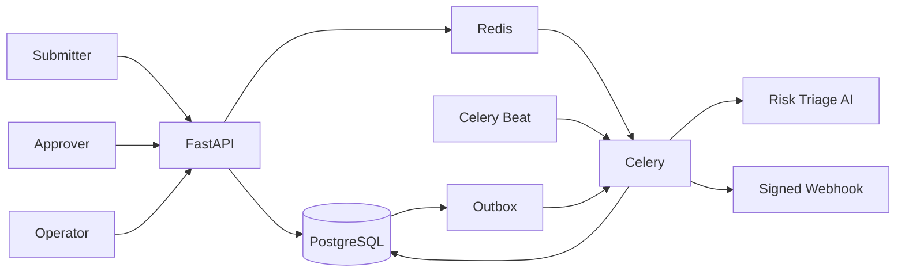

# Secure AI Workflow Orchestrator Pro

Professional-grade portfolio reference implementation for:

**Applied AI + automation + security + regulated workflows**

## What this project proves

- REST API engineering
- durable workflow state
- background queues/workers
- idempotency
- concurrency-safe state transitions
- AI risk triage
- human approval / separation of duties
- retries and backoff
- transactional outbox
- signed webhooks
- failure recovery
- dead letters
- reconciliation of uncertain side effects
- structured logging
- Prometheus metrics
- Alembic migrations
- tests + GitHub Actions

## Explain it like you're 10

Imagine an important school permission form:

```text
Student submits form
        ↓
Office writes it into the official book
        ↓
Robot checks risk
        ↓
Teacher must approve
        ↓
Worker performs the action
        ↓
Another office receives a signed notification
```

If a computer breaks:

```text
Before important action -> safe retry
During important action -> STOP and verify what really happened
```

That second distinction is what makes this project much more serious than a toy task queue.

## 80/20 architecture



## Step 1 — configure

```bash
cp .env.example .env
openssl rand -hex 32
openssl rand -hex 32
```

Use strong values for `JWT_SECRET` and `WEBHOOK_SIGNING_SECRET`, and change all bootstrap
passwords.

## Step 2 — start

```bash
docker compose up --build
```

The stack runs:

```text
PostgreSQL
Redis
Alembic migration
bootstrap users
FastAPI
Celery worker
Celery Beat
```

Open:

```text
http://localhost:8000/docs
```

## Step 3 — learn the three identities

Bootstrap creates:

```text
submitter  -> creates workflow
approver   -> approves/rejects workflow
operator   -> handles failures/reconciliation
```

This is separation of duties.

## Step 4 — login

Use `POST /auth/token` with the submitter credentials from `.env`.

## Step 5 — create a workflow

`POST /workflows`

Headers:

```text
Authorization: Bearer <submitter-token>
Idempotency-Key: case-2026-0001-v1
```

Body:

```json
{
  "case_reference": "CASE-2026-001",
  "description": "Use customer personal data to support an automated credit decision.",
  "input_payload": {"customer_segment": "retail"},
  "callback_url": "http://api:8000/webhooks/demo-partner"
}
```

The API returns `202 Accepted` quickly. Celery continues processing asynchronously.

## Step 6 — prove idempotency

Send the identical request again with the identical `Idempotency-Key`.

Expected:

```text
X-Idempotent-Replay: true
```

Change the body but reuse the key.

Expected:

```text
409 Conflict
```

## Step 7 — observe AI triage

The worker transitions:

```text
RECEIVED
 -> VALIDATING
 -> AI_REVIEW
 -> WAITING_APPROVAL
```

Default `AI_MODE=mock` keeps infrastructure testing deterministic.

To use local Ollama:

```bash
ollama pull qwen3.5:4b
```

Then set:

```text
AI_MODE=ollama
```

The AI may write a risk score/reason, but it **cannot approve or execute** the workflow.

## Step 8 — human approval

Login as the separate `approver` user.

Call:

```text
POST /workflows/{id}/decision
```

```json
{
  "decision": "APPROVE",
  "comment": "Risk reviewed; execution authorized."
}
```

If the creator tries to approve their own workflow while `FOUR_EYES_REQUIRED=true`, the API
rejects it.

## Step 9 — execution

Celery receives the approved job:

```text
APPROVED
 -> EXECUTING
 -> COMPLETED
```

The demo effect is stored in `execution_records` with a UNIQUE workflow/effect key, so task
redelivery does not repeat the logical business action.

## Step 10 — outbox + webhook

The transaction that sets `COMPLETED` also inserts an `outbox_events` row.

Celery Beat periodically dispatches pending outbox rows. The webhook contains:

```text
X-Webhook-Timestamp
X-Webhook-Signature
Idempotency-Key: <stable event UUID>
```

Retryable failures:

```text
timeout / connection error / 429 / 5xx
```

Permanent failures:

```text
most other 4xx
```

Permanent failures go to `dead_letters` rather than retry forever.

## Step 11 — understand safe failure recovery

If VALIDATING/AI_REVIEW gets stuck:

```text
FAILED -> scheduler may safely retry
```

If EXECUTING gets stuck:

```text
NEEDS_RECONCILIATION
```

Why? Because an external effect may already have happened.

The operator must use:

```text
POST /workflows/{id}/reconcile
```

This is more realistic than blind retries.

## Step 12 — run smoke test

```bash
SUBMITTER_PASSWORD='...' \
APPROVER_PASSWORD='...' \
python scripts/smoke_test.py
```

Expected:

```text
created <uuid>
approved
completed
```

## Step 13 — tests

```bash
python -m venv .venv
source .venv/bin/activate
pip install -e ".[dev]"
pytest -q
ruff check .
```

## Step 14 — operational endpoints

```text
GET /health/live
GET /health/ready
GET /metrics
```

Use `/metrics` with Prometheus/Grafana later.

## The five concepts to master for interviews

1. **Idempotency** — duplicate command, one logical effect.
2. **At-least-once delivery** — tasks may execute again.
3. **Transactional outbox** — commit business state and event intent together.
4. **Human authorization boundary** — AI recommends; authorized human decides.
5. **Reconciliation** — uncertain side effects are verified, not blindly replayed.

## Do not add yet

Do not immediately add:

```text
Kafka
Kubernetes
Temporal
microservices
10 AI agents
```

First prove this complete path:

```text
API
-> idempotency
-> queue
-> AI triage
-> human approval
-> idempotent execution
-> outbox
-> signed webhook
-> retry/dead letter
-> recovery/reconciliation
```

See `ARCHITECTURE.md`, `SECURITY.md`, and `INTERVIEW_QA.md`.
